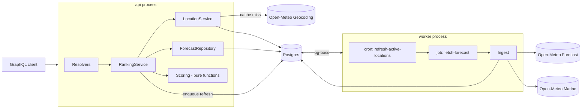

# Architecture

> Related: [Requirements](prd.md) · [Decisions](decisions/) · [Workflow](workflow-lifecycle.md) · [Style guide](styleguide.md) · [Testing](testing.md) · [Implementation plan](implementation-plan.md)

A backend service that takes a city or town and ranks how good each of the next 7 days will be for **skiing, surfing, outdoor sightseeing and indoor sightseeing**, using weather data from Open-Meteo that is persisted and refreshed rather than fetched per request.

What it must do, the assumptions behind it, what is out of scope and the open questions are in the [product requirements](prd.md). This document is how.

## 1. Architecture

A **modular monolith** with two entrypoints from one codebase (`api`, `worker`) sharing **Postgres** for both data and the job queue (pg-boss). Inside, code is split into feature modules that are layered, with ports (interfaces) at the I/O seams ([ADR 0008](decisions/0008-layered-modules-ports-at-seams.md)).



### Request flow
1. Normalise input → look up `location_aliases`; on miss call Geocoding, take the **top match**, store location and alias.
2. Load the location's forecast from Postgres:
   - **Fresh** (latest successful fetch < TTL, default 3 h) → score and return.
   - **Stale** → return with `stale: true` and enqueue a refresh (stale-while-revalidate).
   - **Missing** (cold city) → fetch inline (pg-boss singleton key per location de-duplicates concurrent requests), persist, return.
3. Bump `locations.last_requested_at` (marks the location as active).

### Refresh flow
An hourly cron job selects locations with `last_requested_at > now() - 7d` and stale data, and enqueues `fetch-forecast` jobs (rate-limited, retried with backoff). Locations nobody asks about stop being refreshed automatically.

## 2. Components

| Module | Responsibility |
|---|---|
| `graphql/` | SDL schema, thin resolvers, error mapping to `extensions.code`, depth/cost limits |
| `locations/` | Geocoding client, alias cache, location repository |
| `weather/` | Forecast + Marine clients (zod-validated, timeout, retry), ingest (hourly → daily reduction), repositories |
| `scoring/` | One pure scorer per activity, aggregator, rating thresholds, typed config |
| `jobs/` | pg-boss bootstrap, refresh cron, fetch job |
| `config/` | zod-validated environment |

### Project structure

```
src/
  api.ts                    # api entrypoint + composition root (Yoga HTTP server)
  worker.ts                 # worker entrypoint + composition root (pg-boss)
  config/                   # env schema, scoring config
  db/                       # Drizzle client, schema, migrations
  graphql/                  # schema.graphql, resolvers, scalars, errors
  locations/                # geocoding client, location service, repository
  weather/                  # forecast & marine clients, ingest, repositories
  scoring/                  # activity scorers, curves, aggregator
  ranking/                  # RankingService (orchestrates the request flow), ports.ts
  jobs/                     # pg-boss setup, refresh cron, fetch job
  shared/                   # logging, errors, date utils, http helpers
test/                       # mirrors src/; level in the file suffix (see testing.md)
  fakes/                    # Open-Meteo fake, clock
  fixtures/open-meteo/      # recorded API responses
  scenarios/                # end-to-end GraphQL scenarios
```

Dependency direction: `graphql → ranking ← {locations, weather, jobs}`, `ranking → scoring`, `jobs → weather`, and all modules may import `{db, shared, config}`. `ranking/ports.ts` declares the interfaces it needs (`LocationResolver`, `ForecastReader`, `ForecastFetcher`, `RefreshScheduler`, `Clock`). The adapter modules implement them, and only `api.ts` / `worker.ts` wire concrete classes together. Modules import each other only through their `index.ts`. `scoring` has no I/O and imports nothing but `shared` types and `config`.

### Open-Meteo calls

| API | Endpoint | Key parameters |
|---|---|---|
| Geocoding | `geocoding-api.open-meteo.com/v1/search` | `name`, `count=10`, `countryCode` (filter top match by country when given) |
| Forecast | `api.open-meteo.com/v1/forecast` | `daily=temperature_2m_max,temperature_2m_min,apparent_temperature_max,precipitation_sum,rain_sum,snowfall_sum,precipitation_probability_max,wind_speed_10m_max,wind_gusts_10m_max,sunshine_duration,daylight_duration,weather_code,uv_index_max`, `hourly=snow_depth`, `forecast_days=7`, `timezone=auto` |
| Marine | `marine-api.open-meteo.com/v1/marine` | `daily=wave_height_max,wave_period_max,wave_direction_dominant,swell_wave_height_max,swell_wave_period_max,wind_wave_height_max`, `forecast_days=7`, `timezone=auto` |

## 3. Data model

| Table | Key | Contents |
|---|---|---|
| `locations` | `id` uuid; unique `geocoding_id` | name, country, country_code, admin1, latitude, longitude, elevation, timezone, `has_marine` (null = unknown), `last_requested_at` |
| `location_aliases` | (`normalized_query`, `country_code`) | → `location_id` (geocoding cache) |
| `daily_weather` | (`location_id`, `date`) | temp min/max, apparent temp max, precipitation sum and probability, rain, snowfall, snow depth (daily max of hourly), wind speed and gusts max, sunshine and daylight duration, weather code, UV index |
| `daily_marine` | (`location_id`, `date`) | wave height/period/direction, swell height/period, wind-wave height |
| `forecast_fetches` | `id` | location, source (`FORECAST`/`MARINE`), `fetched_at`, status, error, `raw_payload` jsonb (pruned after N days) |

- Daily rows are **upserted** per fetch; freshness comes from the latest successful `forecast_fetches` row.
- Raw payloads allow re-processing if extracted columns change, and help debugging.
- Scores are **not stored**: they're computed on read from daily rows (microseconds), so scoring changes need no backfill.

## 4. API (GraphQL)

```graphql
scalar Date
scalar DateTime

type Query {
  activityRanking(city: String!, countryCode: String, days: Int = 7): ActivityRanking!
}

type ActivityRanking {
  location: Location!               # what the city resolved to
  forecastFetchedAt: DateTime!
  stale: Boolean!
  activities: [ActivityForecast!]!  # available by score desc, unavailable last
}

type ActivityForecast {
  activity: Activity!
  available: Boolean!
  unavailableReason: String
  score: Int                        # 0–100 weekly aggregate; null if unavailable
  bestDay: Date
  days: [DayScore!]!
}

type DayScore {
  date: Date!
  score: Int!
  rating: Rating!
  reasons: [String!]!
}

type Location {
  name: String!
  country: String!
  countryCode: String!
  admin1: String
  latitude: Float!
  longitude: Float!
  elevation: Float
  timezone: String!
}

enum Activity { SKIING SURFING OUTDOOR_SIGHTSEEING INDOOR_SIGHTSEEING }
enum Rating { POOR FAIR GOOD EXCELLENT }
```

Errors: `BAD_USER_INPUT` (city 1–100 chars, days 1–7, ISO-2 country), `LOCATION_NOT_FOUND`, `UPSTREAM_UNAVAILABLE` (only when no stored data exists).
Operational endpoints: `GET /health` (liveness), `GET /ready` (DB reachable).

## 5. Scoring

Each factor maps to a 0–1 sub-score via piecewise-linear "comfort band" curves; sub-scores are combined as a weighted sum, then **hard caps** apply for dangerous/pointless conditions. Reasons come from the 2–3 most influential factors. Ratings: < 40 POOR, 40–59 FAIR, 60–79 GOOD, ≥ 80 EXCELLENT. Weekly score = mean of daily scores; `bestDay` = argmax.

| Activity | Factors (weight) | Hard caps | Unavailable when |
|---|---|---|---|
| Skiing | snow depth (0.4), fresh snowfall (0.2), temperature (0.15), wind/gusts (0.15), sunshine (0.1) | gusts > 60 km/h; no snow on ground | never (scores low) |
| Surfing | wave height (0.35), swell period (0.3), wind speed (0.25), air temp (0.1) | waves > 4 m; thunderstorm | no marine data |
| Outdoor sightseeing | precipitation (0.35), apparent temp (0.25), sunshine fraction (0.2), wind (0.1), UV (0.1) | thunderstorm, heavy rain/snow | never |
| Indoor sightseeing | baseline 50, rises as outdoor conditions worsen | none | never |

## 6. Tech choices

| Concern | Choice | Why / alternatives |
|---|---|---|
| Runtime | Node 22 LTS, TypeScript strict, ESM | — |
| GraphQL | GraphQL Yoga, SDL + graphql-codegen | Lighter than Apollo Server; SDL is easier to review than code-first (Pothos) |
| Storage | Postgres 17 | Concurrency across two processes, upserts, jsonb, hosts the job queue; SQLite rejected for multi-process use |
| Data access | Drizzle ORM + drizzle-kit migrations | Typed bulk `ON CONFLICT` upserts, no codegen step, SQL-like; Prisma lacks bulk upsert; Kysely/raw `pg` equally viable |
| Jobs | pg-boss | Cron, retries, singleton keys, no extra infra |
| HTTP | native fetch + zod + p-retry | — |
| Logging | pino (+ pino-pretty, rotating file, OTLP transports) | Structured logs with request/job IDs; see [logging](logging.md) |
| Testing | Vitest, Testcontainers, msw | Real Postgres in tests; an Open-Meteo fake over recorded fixtures; see [testing](testing.md) |
| Delivery | Dockerfile, docker-compose (`postgres`, `api`, `worker`), GitHub Actions | One-command local run |

## 7. Key decisions & trade-offs

Full context for each decision lives in the [decision records](decisions/):
[0001 Monolith + Postgres + pg-boss](decisions/0001-monolith-postgres-pg-boss.md) ·
[0002 Hybrid refresh](decisions/0002-hybrid-refresh-strategy.md) ·
[0003 Single-query geocoding](decisions/0003-single-query-geocoding.md) ·
[0004 Scores computed on read](decisions/0004-compute-scores-on-read.md) ·
[0005 Daily granularity, upserted forecasts](decisions/0005-daily-granularity-upsert.md) ·
[0006 Drizzle ORM](decisions/0006-drizzle-orm.md) ·
[0007 GraphQL Yoga, schema-first](decisions/0007-graphql-yoga-schema-first.md) ·
[0008 Layered modules, ports at the seams](decisions/0008-layered-modules-ports-at-seams.md)

| Decision | Trade-off | Alternatives rejected |
|---|---|---|
| **Single query, top geocoding match** | Simple API, but ambiguous names ("Springfield", "Paris") may resolve to the wrong place. Mitigated by the optional `countryCode` and returning the resolved `location` so clients can detect it. | A `searchLocations` + `activityRanking(locationId)` two-step flow; this is the natural next step if ambiguity matters in practice |
| **Monolith + pg-boss, Postgres only** | One piece of infrastructure, simple ops; Postgres carries both data and queue load, which is fine at this scale. Clear improvement path: add a **cache layer** (Redis or in-process LRU) for resolved aliases and computed rankings, and move the queue to BullMQ/Redis if job volume grows. | Redis/BullMQ from day one (extra service, no benefit at current load) |
| **Hybrid refresh** (inline on cold miss + cron for active locations + stale-while-revalidate) | Fast reads and bounded upstream calls; the first request for a new city pays ~1–2 s; the "active" window (7 days) is a tunable heuristic | Lazy-only TTL (every expiry costs a slow request); scheduled fixed list (can't serve arbitrary towns) |
| **Compute scores on read** | Tiny CPU cost per request; scoring changes need no backfill or versioning | Precomputed score tables written by the worker |
| **Daily granularity** | Simple model and API; loses intra-day nuance (morning surf window, afternoon storms) | Hourly storage and scoring |
| **Upsert latest forecast** (plus raw payload log) | Simple reads; no full history of forecast revisions | Append-only snapshots per fetch |
| **Rule-based heuristics** | Transparent, explainable, testable; not empirically validated | ML / learned models (no labelled data) |

## 8. Error handling

- Upstream: 5 s timeout, 3 retries with exponential backoff + jitter on 5xx/429/network errors; no retry on 4xx; every attempt recorded in `forecast_fetches`.
- Partial failure: if Marine fails but Forecast succeeds, surfing is unavailable with "marine data temporarily unavailable", distinct from "no marine forecast (inland)". `has_marine` is only set on a confirmed empty response.
- Upstream down: serve stored data with `stale: true`; `UPSTREAM_UNAVAILABLE` only when nothing is stored.
- Worker: pg-boss retries; persistent failures are logged and retried on the next cron tick without blocking other locations.
- Graceful shutdown on SIGTERM for both processes; query depth/cost limits and per-IP rate limiting on the API.

## 9. Testing

1. **Unit**: scorers (table-driven: blizzard day, perfect beach day, heatwave, inland), aggregation, rating thresholds, timezone/date handling.
2. **Integration** (primary): repositories, ingest, clients, `RankingService` and jobs against real Postgres (Testcontainers), with Open-Meteo replaced by a fake built on msw and recorded fixtures. Nothing of our own is mocked.
3. **End-to-end**: GraphQL queries against the Yoga app covering cold miss, fresh hit, stale-while-revalidate, inland city, unknown city and upstream outage.

## 10. Risks

| Risk | Impact | Mitigation |
|---|---|---|
| Geocoding ambiguity | Wrong place ranked | `countryCode`, resolved location in the response; two-step search as follow-up |
| Snow depth modelled at grid-cell elevation, not resort elevation | Ski scores misleading for valley towns near resorts | Document; future: pass `elevation` or accept resort coordinates |
| Marine API coverage near coastline / grid resolution | Coastal towns marked inland, or vice versa | Treat null as unavailable with an explicit reason; future: nearest-coast lookup |
| Open-Meteo free-tier limits and terms (non-commercial) | Throttling or a licensing issue in production | De-duplication, active-window refresh, backoff on 429; commercial plan for production |
| Heuristic scoring is subjective | Rankings disputed by users/domain experts | Config-driven thresholds, reasons in the output, easy to tune |
| Postgres as both store and queue | Contention at high scale | Fine for this scope; move the queue to Redis/BullMQ if needed |
