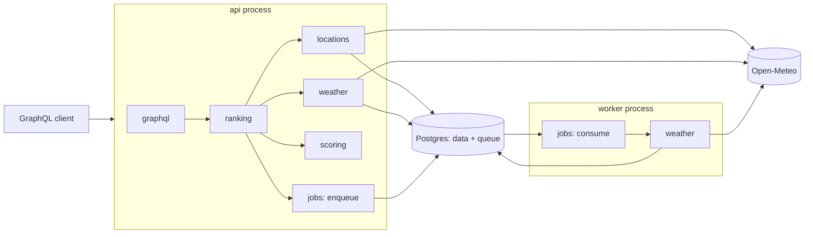

# Architecture

> Related: [Requirements](../prd.md) · [Feature designs](../design/) · [Decisions](../decisions/) ·
> [Style guide](../styleguide.md) · [Testing](../testing.md)

How the system is built: its shape, its parts and the rules between them. What it must do is in the
[product requirements](../prd.md); how each feature is built on this shape is in its
[design doc](../design/).

## Principles

- **A modular monolith** — one codebase, two processes: `api` answers requests, `worker` runs
  background jobs ([ADR 0001](../decisions/0001-monolith-postgres-pg-boss.md))
- **One store** — Postgres holds the data and the job queue, so there is one piece of
  infrastructure to run
- **Modules by feature, layered** — each module owns one part of the domain, dependencies point
  one way only, and there are no cycles ([ADR 0008](../decisions/0008-layered-modules-ports-at-seams.md))
- **Ports at the I/O seams** — the core declares the interfaces it needs; adapters implement them,
  and they are bound together only in the composition roots
- **A pure core** — scoring is plain functions over data: no I/O, no clock, no logging
- **Validation at the boundary** — data from outside (HTTP, environment, GraphQL input) is checked
  where it enters; inside, the types are trusted
- **Schema first** — the GraphQL schema is the contract, and code is generated from it
  ([ADR 0007](../decisions/0007-graphql-yoga-schema-first.md))

## Documents

| File | What it covers |
|---|---|
| [modules.md](modules.md) | The modules, what each owns, how they may depend on each other |
| [ports.md](ports.md) | The seams: the interfaces the core declares and who implements them |
| [bootstrap.md](bootstrap.md) | The composition roots: how the processes and the test app are assembled |
| [runtime.md](runtime.md) | The processes, the database and the queue, and how they meet |
| [configuration.md](configuration.md) | Settings: where they come from, who validates them, who sees them |
| [error-handling.md](error-handling.md) | Errors: the domain errors, their mapping, the rules per layer |
| [logging.md](logging.md) | What is logged, where it goes, and the rules for logging |

## Stack

| Concern | Choice | Record |
|---|---|---|
| Runtime | Node 22 LTS, TypeScript strict, ESM | — |
| API | GraphQL Yoga, SDL + graphql-codegen | [0007](../decisions/0007-graphql-yoga-schema-first.md) |
| Storage | Postgres 17 | [0001](../decisions/0001-monolith-postgres-pg-boss.md) |
| Data access | Drizzle ORM, drizzle-kit migrations | [0006](../decisions/0006-drizzle-orm.md) |
| Jobs | pg-boss | [0001](../decisions/0001-monolith-postgres-pg-boss.md) |
| HTTP | native fetch, zod, p-retry | — |
| Logging | pino and its transports | [logging.md](logging.md) |
| Testing | Vitest, Testcontainers, msw | [testing.md](../testing.md) |
| Delivery | Docker, docker compose, GitHub Actions | — |
