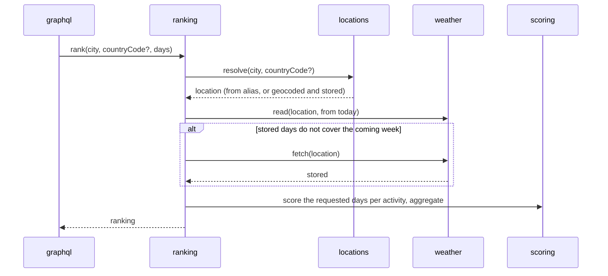

# Activity ranking

> Related: [Requirements](../prd.md) · [Architecture](../architecture/) · Design issue
> [#10](https://github.com/vlgriga/collinson-group/issues/10)

## Context

A client sends the name of a city and gets, for each of the four activities, how good each of the
next days is, a weekly score and the best day, ordered best first. The answer comes from forecasts
stored in Postgres; Open-Meteo is called only when nothing usable is stored.

Requirements: R1–R7; R8 for "not possible here"; R9 for storing and answering from stored data;
R10 for `forecastFetchedAt`; R13; N1, N7.

## Goals and non-goals

- **Goals:** resolve a name to one place; fetch and store its forecast; score every day for every
  activity; answer from stored data while it covers the coming week.
- **Non-goals:**
  - [Refresh](refresh.md): the freshness window, `stale`, `last_requested_at` and the background
    refresh.
  - [Resilience](resilience.md): timeouts and retries, "marine data temporarily unavailable",
    serving stored data when Open-Meteo is down.
  - [Operations](operations.md): limits, health, shutdown, the worker process.

## Design

### Request flow



1. **Validate** the input at the GraphQL boundary (zod): `city` 1–100 characters after trimming,
   `countryCode` ISO 3166-1 alpha-2 (upper-cased), `days` 1–7.
2. **Resolve the place.** Normalise the name (trim, collapse whitespace, lower-case) and look up
   `location_aliases` by (name, country code). On a miss, call Open-Meteo Geocoding, take the
   **top match** ([ADR 0003](../decisions/0003-single-query-geocoding.md)), and upsert the location
   (on `geocoding_id`, doing nothing on a conflict, so two names for one place share it and its
   `has_marine`) and the alias. No match:
   `LocationNotFoundError`.
3. **Load the forecast.** "Today" is the `Clock`'s instant in the place's timezone; the week is the
   7 dates from today. The stored data **covers the week** when each of its dates has a
   `daily_weather` row and, unless `has_marine` is false, a `daily_marine` row. The week is checked
   whatever `days` asks for, so the data used is never more than a day old. If it is not covered,
   the forecast for exactly that week is fetched inline (Forecast and Marine in parallel), upserted,
   and read again; a response that
   does not hold exactly those dates is invalid. How this rule meets the freshness window is
   settled in [Refresh](refresh.md).
4. **Score** the requested days for every activity, aggregate, order, and answer.

### Open-Meteo calls

| API | Endpoint | Key parameters |
|---|---|---|
| Geocoding | `geocoding-api.open-meteo.com/v1/search` | `name`, `count=1`, `countryCode` |
| Forecast | `api.open-meteo.com/v1/forecast` | `daily=temperature_2m_max,temperature_2m_min,apparent_temperature_max,precipitation_sum,rain_sum,snowfall_sum,precipitation_probability_max,wind_speed_10m_max,wind_gusts_10m_max,sunshine_duration,daylight_duration,weather_code,uv_index_max`, `hourly=snow_depth`, `start_date`, `end_date` (the week), `timezone=<the location's>` |
| Marine | `marine-api.open-meteo.com/v1/marine` | `daily=wave_height_max,wave_period_max,wave_direction_dominant,swell_wave_height_max,swell_wave_period_max,wind_wave_height_max`, `start_date`, `end_date` (the week), `timezone=<the location's>` |

Forecast and Marine are asked for the week as explicit dates in the geocoder's timezone
([ADR 0009](../decisions/0009-forecast-week-in-the-location-timezone.md)), so the stored dates and
"today" are the same calendar and a fetch always covers the week it was made for. Responses are
validated with zod. Units are converted at ingest (snow depth m → cm, durations s → h); hourly
snow depth is reduced to its daily maximum.

A single value may be null in a response that is otherwise valid; it is stored as null. A scorer
leaves a null factor out and rescales the other weights. A factor a hard cap depends on (snow
depth, gusts, wave height, weather code, precipitation) is required: when it is null, the day
scores 0 with a reason naming the missing value.

`has_marine` is set from the Marine response: true when any value is present, false when every
value is null (the place has no sea), and left as it was when the call fails. Marine is not called
for a location with `has_marine = false`.

A failed or invalid Open-Meteo response becomes an `UpstreamUnavailableError` in the client that
received it. There are no retries yet.

### Data model

| Table | Key | Contents |
|---|---|---|
| `locations` | `id` uuid; unique `geocoding_id` | name, country, country_code, admin1, latitude, longitude, elevation, timezone, `has_marine` (null = unknown) |
| `location_aliases` | (`normalized_query`, `country_code`) | → `location_id` (the geocoding cache) |
| `daily_weather` | (`location_id`, `date`) | temperature min/max, apparent temperature max, precipitation sum and probability, rain, snowfall, snow depth (daily max of hourly), wind speed and gusts max, sunshine and daylight duration, weather code, UV index |
| `daily_marine` | (`location_id`, `date`) | wave height/period/direction, swell height/period, wind-wave height |
| `forecast_fetches` | `id` | location, source (`FORECAST`/`MARINE`), `fetched_at`, status, error, `raw_payload` jsonb |

- Daily rows are **upserted** per fetch ([ADR 0005](../decisions/0005-daily-granularity-upsert.md)).
- `forecastFetchedAt` is the `fetched_at` of the latest successful `FORECAST` fetch, the source
  three of the four activities are scored from.
- Scores are **not stored**: they are computed on read
  ([ADR 0004](../decisions/0004-compute-scores-on-read.md)).
- `country_code` in `location_aliases` is `''` when none was given, so the key has no nulls.

### API

```graphql
scalar Date
scalar DateTime

type Query {
  activityRanking(city: String!, countryCode: String, days: Int! = 7): ActivityRanking!
}

type ActivityRanking {
  location: Location!               # what the city resolved to
  forecastFetchedAt: DateTime!
  activities: [ActivityForecast!]!  # available by score desc, unavailable last
}

type ActivityForecast {
  activity: Activity!
  available: Boolean!
  unavailableReason: String         # set when not available
  score: Int                        # 0–100 weekly aggregate; null when not available
  bestDay: Date                     # null when not available
  days: [DayScore!]!                # empty when not available
}

type DayScore {
  date: Date!
  score: Int!
  rating: Rating!
  reasons: [String!]!
}

type Location {
  name: String!
  country: String!
  countryCode: String!
  admin1: String
  latitude: Float!
  longitude: Float!
  elevation: Float
  timezone: String!
}

enum Activity { SKIING SURFING OUTDOOR_SIGHTSEEING INDOOR_SIGHTSEEING }
enum Rating { POOR FAIR GOOD EXCELLENT }
```

[Refresh](refresh.md) adds `stale: Boolean!` to `ActivityRanking`.

`days` is non-null with a default, so omitting it means 7. A query the schema itself refuses — a
missing `city`, a `null` or a wrong type — keeps Yoga's `GRAPHQL_VALIDATION_FAILED`: it is a
malformed query, not an invalid value.

Errors: `ValidationError` → `BAD_USER_INPUT`, `LocationNotFoundError` → `LOCATION_NOT_FOUND`,
`UpstreamUnavailableError` → `UPSTREAM_UNAVAILABLE`. Until [Resilience](resilience.md) serves
stored data instead, any Open-Meteo failure during a request answers `UPSTREAM_UNAVAILABLE`.

### Scoring

Each factor maps to a 0–1 sub-score through piecewise-linear "comfort band" curves. Sub-scores are
combined as a weighted sum, then **hard caps** apply for dangerous or pointless conditions. Reasons
come from the 2–3 most influential factors, in English, in metric units. Ratings: < 40 POOR,
40–59 FAIR, 60–79 GOOD, ≥ 80 EXCELLENT.

| Activity | Factors (weight) | Hard caps | Unavailable when |
|---|---|---|---|
| Skiing | snow depth (0.4), fresh snowfall (0.2), temperature (0.15), wind/gusts (0.15), sunshine (0.1) | gusts > 60 km/h; no snow on the ground | never (scores low) |
| Surfing | wave height (0.35), swell period (0.3), wind speed (0.25), air temperature (0.1) | waves > 4 m; thunderstorm | `has_marine = false`, reason "No marine forecast here" |
| Outdoor sightseeing | precipitation (0.35), apparent temperature (0.25), sunshine fraction (0.2), wind (0.1), UV (0.1) | thunderstorm; heavy rain or snow | never |
| Indoor sightseeing | `50 + (100 − outdoor score) / 2`, from the day's rounded outdoor score: 50 on a perfect outdoor day, 100 on the worst. Its reasons are the outdoor day's reasons, prefixed "Outside: " | none | never |

- **Rounding:** every score is rounded half up to an integer where it is computed — a day's score
  once its caps apply, the weekly score once averaged. What is compared afterwards is the integer
  the client sees.
- **Weekly score:** the plain mean of the requested days' scores. Near days do not weigh more.
- **Best day:** the day with the highest score; the earliest wins a tie.
- **Order:** available activities by weekly score, descending; a tie keeps the order of the
  `Activity` enum. Unavailable activities come last, in the same enum order.
- Weights, curve points, caps and rating thresholds are typed configuration in `src/config/`, each
  with the reason for its value (N7).

## Alternatives considered

| Choice | Trade-off | Rejected |
|---|---|---|
| **One query, top geocoding match** ([ADR 0003](../decisions/0003-single-query-geocoding.md)) | Simple API, but ambiguous names may resolve to the wrong place; mitigated by `countryCode` and by returning the resolved location | `searchLocations` + `activityRanking(locationId)`, the natural next step if ambiguity matters in practice |
| **A fetch when the stored week runs out** | The feature stands alone; stored data is used until it no longer covers the coming 7 days, so it is at most a day old | Fetching on every request (breaks R9); coverage of only the requested days (a `days: 1` client would keep a forecast for a week); a TTL here (belongs to Refresh) |
| **Indoor rises as outdoor worsens** | Days differ, and a bad outdoor day ranks indoor high; indoor outranks outdoor whenever outdoor scores below about 67, a GOOD day included. The 50 and the ½ are configuration | A constant score, which never tells days apart |
| **Weekly score as a plain mean** | Easy to explain and check; ignores that day 7 is less certain than day 1 | Lead-time weighting (PRD open question 2) |
| **Scores computed on read** | Tiny CPU cost per request; scoring changes need no backfill | Score tables precomputed by the worker |
| **Daily granularity, upserted, with a raw payload log** | Simple model and reads; loses intra-day nuance and forecast history | Hourly storage; append-only snapshots |
| **Rule-based heuristics** | Transparent, explainable, testable; not empirically validated | Learned models, for which there is no labelled data |

## Testing

- **Unit:** each scorer: the ideal day, the terrible day, each hard cap, the boundaries of each
  curve; the indoor formula; rating thresholds at 39/40, 59/60, 79/80; the weekly mean, the best day
  and its tie; the order and its ties; the hourly → daily reduction; "today" in the place's
  timezone; the input schema.
- **Integration:** ingest and the repositories against real Postgres with the Open-Meteo fake: rows
  stored per fetch, an upsert overwriting overlapping days, `has_marine` set true and false and left
  unchanged on a failure; an Open-Meteo failure, and a response without exactly the asked dates,
  becoming `UpstreamUnavailableError`; the alias cache; a second name for a stored place.
- **End to end**, through `yoga.fetch`: a cold miss, a second request answered from stored data
  with no Open-Meteo call, a stored week that has run out (also for `days: 1`), `countryCode`,
  `days`, an inland city, an inland city whose week has run out (no Marine call), an unknown city,
  invalid input, Open-Meteo failing on a cold miss.

## Risks and open questions

| Risk | Impact | Mitigation |
|---|---|---|
| Geocoding ambiguity | The wrong place is ranked | `countryCode`, the resolved location in the response; a search step later |
| Snow depth is modelled at grid-cell elevation, not resort elevation | Ski scores mislead for valley towns near resorts | Documented; later, accept an elevation or resort coordinates |
| Marine coverage near the coastline | Coastal towns marked inland, or the reverse | An explicit reason in the answer; later, a nearest-coast lookup |
| Until Resilience, any Open-Meteo failure during a request answers `UPSTREAM_UNAVAILABLE` | A marine outage hides the other three activities | Resilience serves stored data and keeps a marine failure to surfing |
| Until Refresh, stored data may be up to a day old | A forecast revision is missed | Refresh adds the freshness window |
| The week runs out at each place's midnight | The first request of the day for a known place pays an inline fetch (~1–2 s), and simultaneous ones each fetch | Refresh settles it, with its de-duplication and the background refresh |
| `has_marine = false` is never re-checked | A coastal place with one all-null Marine response loses surfing for good | Accepted: an inland point's Marine response is null by the model's grid, not by chance; a re-check if it shows |
| An unknown name is not cached | Each repeat of a misspelled or random name calls Geocoding | Rate limiting in [Operations](operations.md); a negative cache if it shows |
| Heuristic scoring is subjective | Rankings disputed | Thresholds in configuration, reasons in the output |
