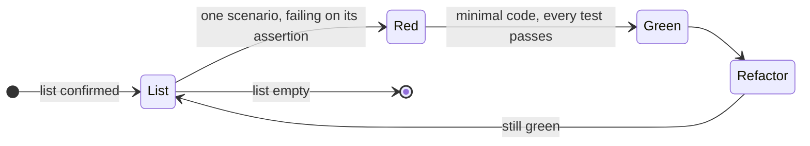

# Testing

> Related: [Architecture](architecture/) · [Workflow](workflow-lifecycle.md) · [Style guide](styleguide.md)

## Context

There is no staging environment. The automated tests are the only place a regression is caught
before it ships, so the strategy leans on real infrastructure rather than isolation: real Postgres,
real pg-boss, the real composition. Only Open-Meteo, which we don't own, is replaced.

## Principles

In priority order.

1. **Behaviour is tested, not implementation.** A test names what the code promises, not how it
   does it today.
2. **Integration tests are the primary level.** They run against a real database, through real
   repositories and the real job queue.
3. **Nothing of our own is mocked.** Only a third-party dependency is replaced, and only by a
   [fake](#isolating-dependencies): a working implementation of the same contract. One exception:
   [fault injection](#fault-injection).
4. **Infrastructure is production-like.** Postgres 17, the same major version as production, in a
   container, with the schema the migrations produce.
5. **Given, when, then.** Comments split the test body into those three, with exactly one *when*.
   A refusal checked with `await expect(…).rejects.toThrow(…)` reads `// When / Then`.
6. **One test, one case.** Several cases are several tests; the same case with different data is
   `it.each`.
7. **Complete isolation.** A test starts clean and leaves clean. Order is not part of the contract:
   a test passes first, last and in any combination. Order is shuffled on every run.
8. **Parallel by default.** No shared mutable state between tests or files.
9. **Speed is a requirement.** A slow test is a defect to fix, not something to move into a
   separate suite.
10. **Names describe behaviour**, not the function underneath.
11. **No sleeping.** "Now" comes from the injected `Clock`; two records that differ in time get
    their times through it, or have the value written directly. Retry delays are configuration and
    the test app sets them to zero. Any `setTimeout` used to wait in a test is a defect.

## What is covered where

Each level asks a different question. Unit: how something behaves. Integration: what the system is
left holding. End to end: whether a scenario a real client could walk through comes out right.

| Level | Suffix | Where it applies | Reaches |
|---|---|---|---|
| **Unit** | `.unit.test.ts` | Behaviour that the arguments alone settle: scorers, curves, aggregation, rating thresholds, date utilities, the hourly → daily reduction, response mappers, zod schemas. | Nothing |
| **Integration** (primary) | `.int.test.ts` | State the infrastructure is left holding: repositories, ingest, Open-Meteo clients (retry, timeout, validation), `RankingService`, jobs. | Postgres, fake Open-Meteo |
| **End to end** | `.e2e.test.ts` | A course of events a client could produce: GraphQL requests through `yoga.fetch`, from a starting state to the answer and what is stored afterwards. | Postgres, fake Open-Meteo |

The suffix declares the level, and the level is what a run narrows to (one Vitest project per
level). A `*.test.ts` file without a level suffix fails the run; `vitest.config.ts` checks that
every test file matches exactly one project. A unit test that asks for the database or the test app
fails with a message saying so, because the unit project starts no infrastructure.

A scoring rule earns a unit test that names it even when an e2e test exercises it too. The rule is
worth pinning, and a failure should say which rule broke.

There is no target number of tests and no ratio between levels. A case exists because some
behaviour needs it. Coverage is reported (`npm test -- --coverage`) but not gated: a low number is
a reason to look, not a reason to write a test.

## What must be covered

The scenarios the architecture commits to, by level:

- **Scoring** (unit): per activity — ideal day, terrible day, each hard cap, boundary values of
  each curve (first and last accepted value, first not accepted), inland surfing, no-snow skiing;
  rating thresholds at 39/40, 59/60 and 79/80; weekly mean and `bestDay`.
- **Ingest** (integration): hourly → daily snow-depth reduction, upsert overwrites overlapping
  days, a confirmed empty marine response sets `has_marine = false` while a marine failure leaves
  it unchanged, and every attempt is recorded in `forecast_fetches`.
- **Open-Meteo clients** (integration): retry on 5xx/429/network error, no retry on 4xx, timeout,
  a response that fails zod validation.
- **Request flow** (e2e): cold miss, fresh hit, stale-while-revalidate (`stale: true` and a refresh
  job enqueued), inland city, unknown city (`LOCATION_NOT_FOUND`), upstream down with stored data
  (stale) and without (`UPSTREAM_UNAVAILABLE`), invalid input (`BAD_USER_INPUT`).
- **Concurrency** (e2e): two simultaneous cold-miss requests for the same city produce one upstream
  fetch.
- **Worker** (integration): the refresh cron enqueues jobs only for active and stale locations.

## Where a test enters

A test enters the way the code's callers do. A scoring rule is tested by calling the scorer, a use
case through its service, a job through the handler pg-boss calls, and the API through
`yoga.fetch`.

An integration test builds the app through the test composition root, calls the service, and
checks the result and what is stored afterwards:

```ts
describe('RankingService rank', () => {
  it('serves the stored forecast without calling Open-Meteo while it covers the week', async () => {
    // Given
    const app = await createTestApp({ clock: fixedClock('2026-10-18T09:00:00Z') });
    const chamonix = await storeLocation(app.db, buildLocation({ ...CHAMONIX, hasMarine: false }));
    await storeForecast(app.db, buildForecast({ location: chamonix, firstDate: '2026-10-18', fetchedAt: '2026-10-18T08:00:00Z' }));

    // When
    const ranking = await app.ranking.rank({ city: 'Chamonix' });

    // Then
    expect(ranking.forecastFetchedAt).toEqual(new Date('2026-10-18T08:00:00Z'));
    expect(app.openMeteo.requests).toHaveLength(0);
  });
});
```

`createTestApp` wires the app with the same composition function that `api.ts` and `worker.ts` use,
and differs only in the fakes and configuration it passes in. A module that the composition does
not wire is a module no test reaches.

## Test data

There are three kinds of helper, named by what they touch:

| Prefix | Does | Reaches | Used by |
|---|---|---|---|
| `build…` | Builds a value or chain in memory (`buildDay`, `buildLocation`, `buildForecast`) | Nothing — collaborators passed in | Any level |
| `store…` | Persists a built chain, or a change to stored state | Database | Integration, e2e |
| `read…` | Reads stored state back for *then* | Database | Integration, e2e |

- `build…` starts from a named, unremarkable baseline (a mild, dry day) and takes overrides for
  what the test is about: `buildDay({ snowDepthCm: 120 })`. Anything the test asserts on is passed
  explicitly, never left to the default.
- A unit test's subject is called in the test itself. `build…` only assembles its inputs.
- A helper takes the parent when the test cares which one it is: the daily rows of one forecast
  share that forecast's location.
- A test changes a built chain in *given* and then stores it. Helpers take no callback that does
  this for the test.
- Helpers shared across files live in the module's `factories/` directory, one file per subject,
  next to its literals.
- No faker, fishery or similar generators. Weather values decide scores; a random value makes the
  expected score meaningless.

## Fixtures

- Real Open-Meteo responses are recorded once into `test/fixtures/open-meteo/`
  (`forecast-chamonix.json`, `marine-biarritz.json`, `marine-inland-null.json`,
  `geocoding-paris.json`, …). `scripts/record-fixtures.ts` refreshes them, and they are committed.
- The [Open-Meteo fake](#isolating-dependencies) serves them, rebasing their dates to the
  `start_date`–`end_date` it is asked for ([ADR 0009](decisions/0009-forecast-week-in-the-location-timezone.md)).
- Scorer tests build their inputs with `build…` helpers, not from JSON.

## Literals

The magic-number lint rule is off under `test/`: a literal there is an expected value from outside
the code.

- Used once: inline.
- Named: when the value carries meaning beyond itself, or repeats within a file.
- Shared across files: a small fixed set per subject in the module's `factories/`
  (`CHAMONIX`, `BIARRITZ`, `INLAND_MADRID`). One value, one name.
- Request and answer literals shared across files (GraphQL documents, error codes): the module's
  `support.ts`.

## Parametrization

- One behaviour per test. Several refusals share a test only when the behaviour is the same for any
  of them, e.g. every invalid input answers `BAD_USER_INPUT` and stores nothing.
- No branching on a parameter in *given* (`vitest/no-conditional-in-test`). Two setup shapes are a
  builder passed as a parameter, or two tests.
- Parameter values are immutable (`as const`). A value the test changes is built inside the test.
- Titles name the case: `it.each(cases)('caps skiing at 20 when gusts are $gustsKmh km/h', …)`.

## Fault injection

Atomicity, races and retries need a step that fails or waits at a chosen point.

- **At Open-Meteo**, the fake does it: it can answer with a status, fail the connection, answer a
  forecast for other dates than those asked for, or hold a response until the test releases it. The
  concurrency scenario holds the first forecast request,
  sends the second GraphQL request, then releases.
- **Inside our code**, and only there, a test may pass its own port implementation or a subclass of
  one of our adapters to `createTestApp`. It fails or waits at one named step, and its name says
  what goes wrong: `MarineRepositoryFailingOnUpsert`. The override lives only in the app that test
  builds, so there is nothing to restore.

## TDD

A test written after the code is shaped by it. It checks the cases the author remembered, and it
has never been seen to fail, so nothing shows that it catches the break it exists for. With TDD
the test comes first: it states the requirement before the design settles, and its first failure
proves it can fail.

Whether an issue is done with TDD is the author's call, asked once before any code (see
[workflow](workflow-lifecycle.md#before-the-implementation)); the alternative is tests after code. An agent
with nobody to ask does not assume TDD.

### The scenario list

Before the first test, the issue's acceptance criteria become a scenario list. A test is owed to a
requirement, not to a new function or class, so the list is built from what the issue asks, not
from the code expected to answer it. Each requirement yields:

- the behaviour it asks for, e.g. *"surfing is unavailable when the marine response is null"*;
- each way it can be refused — invalid input, an unknown city, an unavailable upstream;
- its boundaries — the first and last accepted value, and the first one not accepted.

Each scenario names its entry point (scorer, service, job handler, GraphQL request), and so its
level. Most scoring scenarios start as unit tests; behaviour that crosses modules starts as a
failing e2e or integration test, and the units are driven out beneath it. The author confirms the
list and the entry points together, once. A test at the wrong entry point is written only to be
thrown away, and a requirement with no scenario on the list is a requirement nothing checks.

### The cycle

The list is worked one scenario at a time:



1. **Red.** One scenario becomes a test, seen failing for the missing behaviour — on its assertion,
   not on an import or a type error. A test that passes at once checks something that exists
   already, or nothing.
2. **Green.** Only enough code to make that test and every earlier one pass. Anything beyond is
   untested by construction.
3. **Refactor.** On green only: the structure improves, behaviour and tests stay the same. It is
   not mixed into step 2, or a failure has two possible causes. A test that must change here was
   testing implementation.
4. **Back to the list.** A scenario found on the way goes on the list, not into the current test.
   Tests written in bulk describe imagined behaviour and fix the structure before the
   implementation has taught anything.

Two rules hold in every cycle:

- **An expected value comes from outside the code** — a literal, a worked example, the
  architecture's scoring table. A value recomputed the way the code computes it, or copied from its
  output, passes by construction.
- **A defect starts as a test that reproduces it**, and is fixed when that test passes.

Each passing scenario is a natural commit (`test(scoring): #12 …` + `feat(scoring): #12 …`, or one combined
commit). The cycle runs on a narrowed run (`npm run test:unit -- surfing`); the whole suite runs in
`make gate` before the push. The work is done when the list is empty and every scenario has a test
that names it.

## Isolating dependencies

This is where the line falls between our code and someone else's.

| | Ours | Third-party (Open-Meteo, system clock) | Infrastructure (Postgres, pg-boss) |
|---|---|---|---|
| Mocks | forbidden | forbidden | forbidden |
| Fakes | not applicable | **required** | not applicable |
| The real thing | required | where possible | required, in a container |

A **fake** is a working implementation of the same contract with its own state. A test uses it the
way the code uses the real service, rather than scripting it for the occasion. There is one fake
per third-party dependency, shared by all tests, in `test/fakes/`:

- `open-meteo.ts` — msw handlers backed by the recorded fixtures. It answers geocoding, forecast and
  marine requests for the places it knows, returns an empty geocoding result for a name it doesn't,
  fails the test on a forecast it has no recording for, records the requests it received, and
  takes the failure controls above. msw runs with
  `onUnhandledFrame: 'error'`, so no test reaches the real API.
- `clock.ts` — `fixedClock(instant)`, which a test can advance.

A test may assert on what the fake received when the requirement is about the boundary itself, e.g.
"one upstream fetch" or "no call when fresh". That is the behaviour Open-Meteo sees.

A **mock** — *when this is called, return that* — is forbidden everywhere, including `vi.mock`,
`vi.fn().mockReturnValue` and `vi.spyOn` on our own modules. It confirms that the code called the
right internals, not that anything works. Vitest fake timers are not used either: time comes from
the `Clock`, and retry delays come from configuration.

## Environment

- **Database.** `globalSetup` starts one Postgres 17 container per run, applies the migrations once
  to a template database, and gives each Vitest worker its own database copied from it
  (`test_${VITEST_POOL_ID}`).
- **Schema from migrations**, so tests also prove the migrations apply. `make gate` checks that
  `drizzle-kit generate` produces no new migration, which means schema and migrations agree.
- **Isolation between tests** by truncating every table, pg-boss's included, before each test. The
  clean database is something a test asks for (`await useDatabase()`, which `createTestApp` calls),
  not something applied to every file: asking is what grants storage access.
- **The app is built per test** by `createTestApp`, and closed when the test ends. It holds no state
  beyond the database, so nothing leaks between tests and an override needs no restoring.
- **Resources** opened for setup or reading (pg-boss instances, extra connections) are closed in the
  same test with `await using` or `try/finally`.
- **No global seeding.** Test data is created in the test through helpers named for what they make.

## Layout

`test/` mirrors `src/` and is grouped by subject, not by level. The suffix is the level, and the
directory does not repeat it:

```
test/
  global-setup.ts              # starts Postgres once per run, migrates the template database
  database.ts                  # the worker's database, and how a test gets a clean one
  app.ts                       # createTestApp: the composition root a test reaches through
  fakes/                       # Open-Meteo, clock
  fixtures/open-meteo/         # recorded responses the fake serves
  scenarios/                   # end-to-end GraphQL scenarios
    support.ts                 # GraphQL documents, error codes
  <module>/                    # scoring, weather, locations, ranking, jobs
    factories/<subject>.ts     # build…, store…, read… helpers and shared literals
    support.ts                 # what the module's tests share that is not a factory
    <subject>.<level>.test.ts
```

- A module has as many test files as subjects under test, and one file holds one subject:
  `scoring/surfing.unit.test.ts`, `weather/ingest.int.test.ts`.
- `describe` names the subject and operation (`'RankingService rank'`); `it` names the behaviour:
  `it('caps skiing at 20 when gusts exceed 60 km/h')`,
  `it('answers LOCATION_NOT_FOUND for a city the geocoder does not know')`.
- An e2e scenario's *when* may be several steps of one course of events: a request, then running
  the refresh job it enqueued.

## Running them

```bash
npm run test:unit          # seconds, no Docker
npm run test:integration   # requires Docker
npm run test:e2e           # requires Docker
npm test                   # everything; what make gate and CI run
npm test -- --coverage
```

A run narrowed to one level starts only what that level needs, so a mid-work check costs seconds.
A test that needs something that was not started fails and says so. The shuffle seed is printed on
every run; `--sequence.seed=<n>` reproduces an order-dependent failure.

## Not allowed

- Mocking our own services, repositories, clients, jobs or utilities.
- A private (unexported) function as a test subject at any level. Writing rows directly to arrange
  state is allowed.
- Sharing mutable state between tests.
- `it.only` (`vitest/no-focused-tests`), and `it.skip` without a comment stating the reason and the
  date.
- Several cases in one test.
- Waiting on real time to control ordering or a race.
- `it.concurrent` or `describe.concurrent` in a test that reaches the database: the tests of a
  worker share its database and run one at a time. Parallelism comes from the workers.
