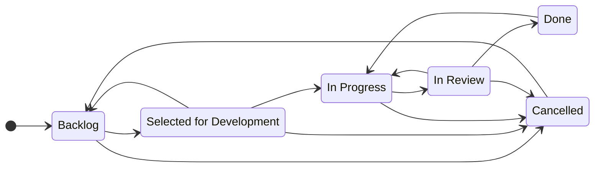

# How work flows

The [product requirements](prd.md) are planned a feature at a time into a design doc and issues.
An issue becomes a worktree, a worktree becomes a pull request, and a pull request becomes a
squashed commit on `main` once the author has approved it. `main` is the deliverable; there are
no tagged releases.

Each step is one `make` target, and each target does what the step means: `start` cuts the branch
and moves the issue, `gate` is the check before the push, `pr` opens the draft once the shallow
review is done, `ready` lifts the draft for the deep review, and `merge` applies the merge settings
rather than leaving them to hand.

The parts that matter are written where they are enforced — the commit grammar and scopes in
`commitlint.config.js`, the branch template in the `Makefile`, the labels and areas in
`.github/labels.yml`, the board in `scripts/board.sh`. How branches, commits and pull requests are
shaped is in [git-flow.md](git-flow.md); what the review steps are for is [below](#review).

## The issue

Work starts from a GitHub issue, and the branch carries its number, so an issue, a branch, a commit
and a pull request are the same thing seen from four sides:

| Side | Shape | Example |
|---|---|---|
| Issue | `#<n> <title>` | `#12 Surfing scorer` |
| Branch | `<type>/<n>-<slug>` | `feature/12-surfing-scorer` |
| Pull request | `<type>(<scope>): #<n> <description>` + `Closes #<n>` in the body | `feat(scoring): #12 add surfing scorer` |
| Commit on `main` | the PR title + the PR number | `feat(scoring): #12 add surfing scorer (#34)` |

The branch type is a [Conventional Branch](https://conventionalbranch.org/) type, the commit type a
Conventional Commits one; both lists and the full grammar are in [git-flow.md](git-flow.md).

**Areas** say which parts of the service the work touches. They are `area:*` labels from a curated
set, and every issue carries at least one. An issue without one is a defect: it is the only axis
nothing else can recover. An area is not a commit scope: the scope names the module one commit
changes ([git-flow.md](git-flow.md#scopes)).

| Label | Covers |
|---|---|
| `area:api` | GraphQL schema, resolvers, HTTP server |
| `area:locations` | Geocoding, location resolution |
| `area:weather` | Open-Meteo clients, ingest, weather repositories |
| `area:scoring` | Activity scorers, aggregation |
| `area:jobs` | pg-boss, refresh and retention jobs |
| `area:db` | Schema, migrations |
| `area:infra` | Docker, CI, tooling |
| `area:docs` | Documentation |

**Labels** carry what no field answers: `bug`, `blocked`, `needs-decision`, `tech-debt`. Which
labels exist, and what each means, is declared in `.github/labels.yml` and synced by
`scripts/board.sh labels`. Adding one there is a decision; using one that is not there is a typo
waiting to become a second spelling.

An issue states what is wanted and how we'll know it is done: a short description, the
requirements it covers and acceptance criteria. Issues come from [planning](#planning).

## Planning

Work is planned a feature at a time, when the author asks for it, with the `/plan-feature` skill,
best run in plan mode. A feature is a capability the author names — activity ranking, background
refresh.

1. **Requirements.** The feature is read against the [PRD](prd.md), the
   [architecture](architecture/), the [decisions](decisions/) and what is already delivered, and
   the author is asked until it is clear which requirements it covers and which it doesn't.
2. **Design.** How the feature is built, within the architecture: the modules it touches, data
   flow, data model and API changes, error handling, alternatives, testing, risks. It becomes the
   feature's design doc, `docs/design/<feature>.md`.
3. **Steps.** The feature is cut into steps. Each is a vertical slice, shown working through its
   entry point, small enough for one pull request, and leaves `main` green; the first step of the
   first feature is a tracer through every layer. Each names the requirements it covers, its
   acceptance criteria and what it is blocked by.
4. **Approval.** The author approves the proposal or edits it. Nothing is filed before that.
5. **Issues and the design doc.** A GitHub milestone named for the feature holds a "Design" issue
   and one issue per step, each blocked by the design issue, on the board in *Backlog*. The design
   doc is written under the design issue and goes through a pull request like any other change.

Once the design is merged, each step is done in a session of its own, with the `/do-issue` skill:
the [flow](#the-flow) below, from the TDD question to a ready pull request.

## Before the implementation

The author decides whether the work is done with TDD. Whoever does the work asks once, before any
code. If the answer is yes, the next step is the scenario list drawn from the acceptance criteria,
which the author confirms. The choice stays with the author because TDD changes how the work is
done, not what it delivers. How TDD work goes is in [testing.md](testing.md#tdd).

## The flow

```bash
make start ISSUE=12                         # worktree + branch feature/12-<slug>, issue → In Progress
make start ISSUE=12 TYPE=bugfix             # another branch type; feature is the default
make start ISSUE=12 TITLE="<title>"         # state the title and skip reading it from the issue
make gate                                   # check, all tests, build (also the pre-push hook)
make pr                                     # gate, push, open draft PR "Closes #12"
make ready                                  # lift the draft, issue → In Review
make merge                                  # on the author's go-ahead: squash-merge, remove worktree

make cleanup                                # remove the worktree, from inside it
make cleanup NAME=<directory>               # or name it from anywhere
```

- **`start`** reads the issue title through `gh`, derives the slug, creates a worktree in
  `../collinson-group-worktrees/<n>-<slug>` on a new branch from `origin/main`, links `.env` from
  the main checkout, and moves the issue to *In Progress*. Run `make install` in a new worktree. Postgres
  from `docker compose` is shared; tests use their own containers, so worktrees don't interfere.
- **`gate`** must pass before anything is pushed. The pre-push hook runs it, and CI runs it again.
- **`pr`** refuses a branch that doesn't match the template. Run the shallow review before calling it.
- **`ready`** marks the PR ready for review. The deep review happens here.
- **`merge`** runs only once the author, having reviewed the pull request, has said to merge it;
  a go-ahead covers that one pull request. It refuses a PR that is not
  [ready to merge](git-flow.md#ready-to-merge), composes the
  [squash message](git-flow.md#the-squash-message), squash-merges and runs `cleanup`; the
  repository deletes the remote branch. Merging closes the issue, and the board moves it to *Done*.
- **`cleanup`** removes a worktree and its local branch, and stops with uncommitted changes or
  commits not on `origin` unless given `FORCE=1`.

Commits on the branch can be as granular as is useful; the commit-msg hook checks their grammar and
the branch name, and CI checks the PR title, because that becomes the commit on `main`.

## Review

Reviews are done with Claude Code's `/code-review`. The level is chosen to fit the step.

- **Shallow — before `make pr`:** `/code-review low`. It catches obvious defects while they're
  still cheap: wrong logic, missing error handling, leftovers. Fix the findings, or answer them in
  the PR description.
- **Deep — after `make ready`:** `/code-review high` on the PR. It checks correctness against
  [architecture](architecture/), test coverage against [testing](testing.md), and conventions
  against the [style guide](styleguide.md). Every finding is fixed or answered before merge.

A design deviation found in review doesn't get settled in the PR thread. It becomes an
[ADR](decisions/) or a follow-up issue.

Who checks what at each depth, against which document, and how the deep review loops until nothing
blocking is left, is in [review.md](review.md).

## Board

The board is a GitHub Project (v2) with a single-select **Status** field.



**The state is moved as the work moves, not reconstructed at the end.** A board read at any moment
should say where the work actually stands; one brought up to date afterwards says only that
somebody remembered. So the transition belongs to the step that caused it and is made then, by
whoever is working the issue.

| Transition | Moved by |
|---|---|
| new issue → *Backlog* | Project workflow "Auto-add to project" + "Item added → Backlog" |
| → *Selected for Development* | by hand, when the issue is next |
| → *In Progress* | `make start` |
| → *In Review* | `make ready` |
| → back to *In Progress* | by hand, when review sends work back |
| → *Done* | Project workflows "Pull request merged" / "Item closed" |
| → *Cancelled* | `scripts/board.sh cancel <n>`, which also closes the issue as *not planned* |

GitHub doesn't see a branch being cut, so `make start` moves that one. A merge it does see.
"Item closed" can't tell *completed* from *not planned*, which is why cancelling goes through the
script.

**An issue is done once its work is merged**, and not before. Checks passing, a review with
nothing left to answer, an approval — all of that is still work in review.

**The board permits any status to follow any other.** The diagram is the agreement, not a
restriction the tool enforces. What is enforced lives in the git process: `main` is protected,
and nothing reaches it without a pull request and a green CI.

## Reaching the board

The board sits behind [`scripts/board.sh`](../scripts/board.sh) (`move <n> <status>`,
`cancel <n>`, `labels`), so which project, field and option IDs are used stays one declaration at
the top of that script rather than a habit spread across the Makefile. Reach for it first; what it
does not cover, do with `gh issue` / `gh project`; what `gh` cannot do, through the GitHub MCP; and
what none of them can settle, ask.

## Local setup

What the machine needs, how to set it up, the checks to run while working, schema changes and
where the configuration lives are in [getting-started.md](getting-started.md).

## CI

GitHub Actions on every PR and push to `main`: PR-title and branch-name check, then `npm ci` →
`make gate`, the same check the pre-push hook runs: lint, format check, typecheck, every test level
against Postgres in Testcontainers, build.
Branch protection on `main` is in [git-flow.md](git-flow.md#ready-to-merge).

## Definition of done

- Behaviour matches the issue's acceptance criteria and the [architecture](architecture/); any
  significant deviation is recorded as an [ADR](decisions/).
- Tests are added at the right layer ([testing](testing.md)), and `make gate` and CI are green.
- Code follows the [style guide](styleguide.md).
- Shallow and deep review findings are fixed or answered.
- The author has reviewed the pull request and approved the merge.
- Commits, PR title and description follow [git-flow.md](git-flow.md), deliberate choices recorded
  as `Decision:` footers.
- Docs are updated if behaviour, config or scripts changed.
- Merged. Until then, it isn't done.
